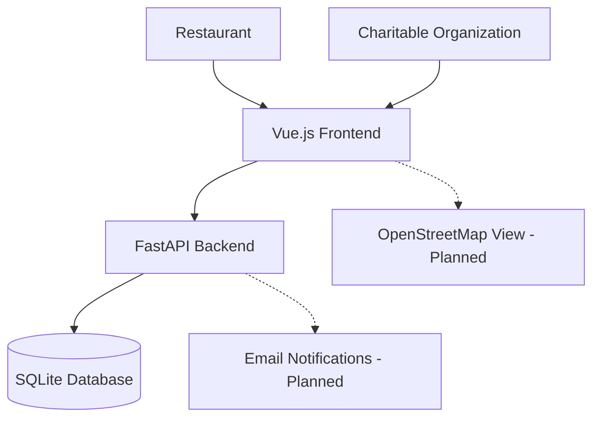

# Ulesh — System Architecture

## 1. Overview

Ulesh is a platform designed to connect restaurants with charitable organizations across Kazakhstan. Its main goal is to reduce food waste by helping restaurants donate surplus food to people in need.

The platform supports three Sustainable Development Goals:
- **SDG 2 — Zero Hunger:** helping charitable organizations provide food to people in need.
- **SDG 12 — Responsible Consumption and Production:** reducing food waste.
- **SDG 17 — Partnerships for the Goals:** connecting businesses with non-profit organizations.

This document describes the proposed system architecture and planned technical structure of Ulesh. It does not claim that all components or features have already been implemented.

## 2. Technology Stack

The proposed technology stack includes:

| Component | Technology | Purpose |
|---|---|---|
| Frontend | Vue.js | User interface for restaurants and charitable organizations |
| Backend | FastAPI | API, business logic, and request processing |
| Database | SQLite | Initial storage for user accounts, food listings, and donation requests |

### 2.1 Database Scalability

SQLite is selected for the initial version of Ulesh because it is lightweight and suitable for a basic application workflow.

If the platform grows and requires more advanced database capabilities, PostgreSQL may be considered as a future alternative. Such a migration has not been implemented or confirmed.

## 3. Main System Components

### 3.1 Frontend — Vue.js

The frontend provides the user interface for two types of participants:

- **Restaurants:** manage their accounts and publish, edit, or cancel food donation listings.
- **Charitable organizations:** browse available donations and submit pickup requests.

### 3.2 Backend — FastAPI

The backend is responsible for:
- Processing registration and login requests.
- Managing restaurant and charity accounts.
- Handling food donation listings.
- Processing pickup requests.
- Managing donation statuses.
- Communicating with the database.

### 3.3 Database — SQLite

The database is intended to store:
- User and organization information.
- Restaurant donation listings.
- Food details, quantities, and expiry information.
- Pickup requests.
- Donation statuses.

### 3.4 Additional Services

The following features are considered for future development:
- Email notifications about donation requests and status changes.
- A map view of nearby food listings using OpenStreetMap.

These features are marked as planned in the project README.

## 4. System Workflow and Data Flow

The proposed workflow consists of the following steps:

1. **Registration:** restaurants and charitable organizations create accounts.
2. **Manual verification:** participants are verified before they can publish or request donations.
3. **Donation listing:** a restaurant publishes information about available surplus food, including its name or description, quantity, expiry or best-before time, pickup address, and pickup window.
4. **Browsing:** a charitable organization views available food listings.
5. **Pickup request:** the organization submits a request for a selected donation.
6. **Confirmation:** the restaurant reviews and confirms the request.
7. **Collection:** the charitable organization collects the food during the agreed pickup window.
8. **Completion:** both sides mark the donation as completed.

## 5. Proposed Architecture Diagram

The diagram represents the proposed structure. Dashed connections indicate features planned for future development.

## 6. Safety and Do No Harm

Ulesh follows the safety principles described in the project README:

- **Food safety:** restaurants should only list food that is safe to eat, correctly stored, and within its expiry or best-before time. Listings should include handling and allergen information. Responsibility for food quality remains with the donating restaurant.
- **Verified participants:** restaurants and charitable organizations are subject to manual verification before posting or claiming donations.
- **Non-discrimination:** all verified charitable organizations should have equal access to listings, regardless of their size, location, or beneficiaries.
- **Respectful community:** all participants and contributors are expected to follow the project's Code of Conduct.

## 7. Platform Independence

Ulesh aims to support platform independence through the following design principles:

- **Open technologies:** Vue.js, FastAPI, and SQLite are used in the proposed technology stack.
- **Modular structure:** frontend, backend, and database responsibilities are separated.
- **Portable data storage:** the initial database can be managed without depending on a proprietary database service.
- **Reduced vendor dependency:** the architecture does not require a specific proprietary cloud platform.
- **Future flexibility:** individual components may be replaced or extended as the project develops.

The project also aims to support self-hosted deployments, allowing deployment operators to control their own data and infrastructure.

## 8. Future Development

Possible future improvements include:
- Considering PostgreSQL if database requirements increase.
- Adding email notifications.
- Implementing a map view using OpenStreetMap.
- Supporting Kazakh, Russian, and English interfaces.
- Introducing donation statistics.

These improvements are not presented as completed functionality.

## 9. Summary

The proposed Ulesh architecture uses Vue.js for the frontend, FastAPI for the backend, and SQLite for initial data storage. Its structure is designed to support the main donation workflow between restaurants and charitable organizations while considering safety, privacy, and platform independence.
